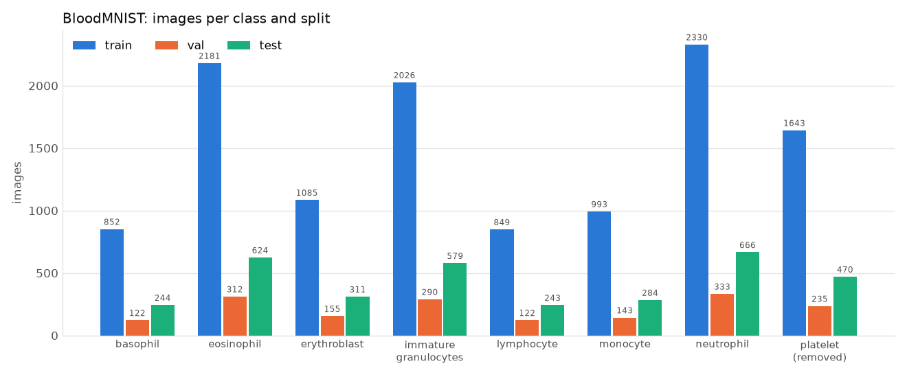
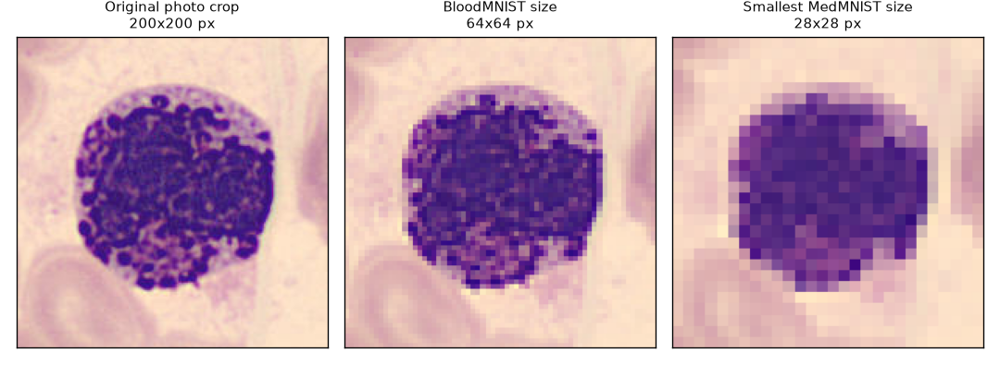
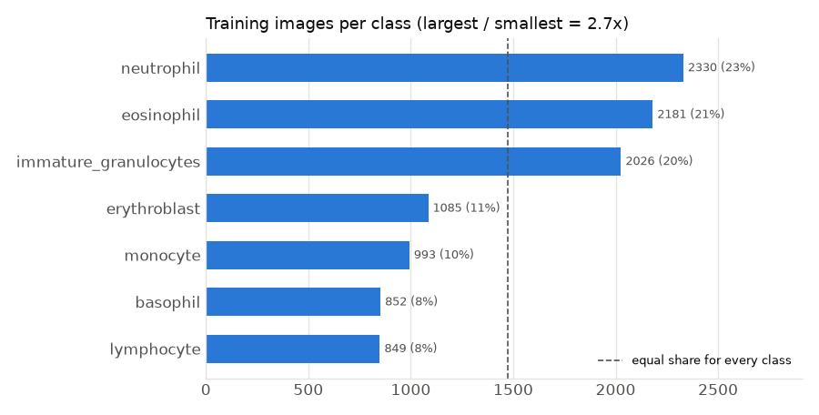
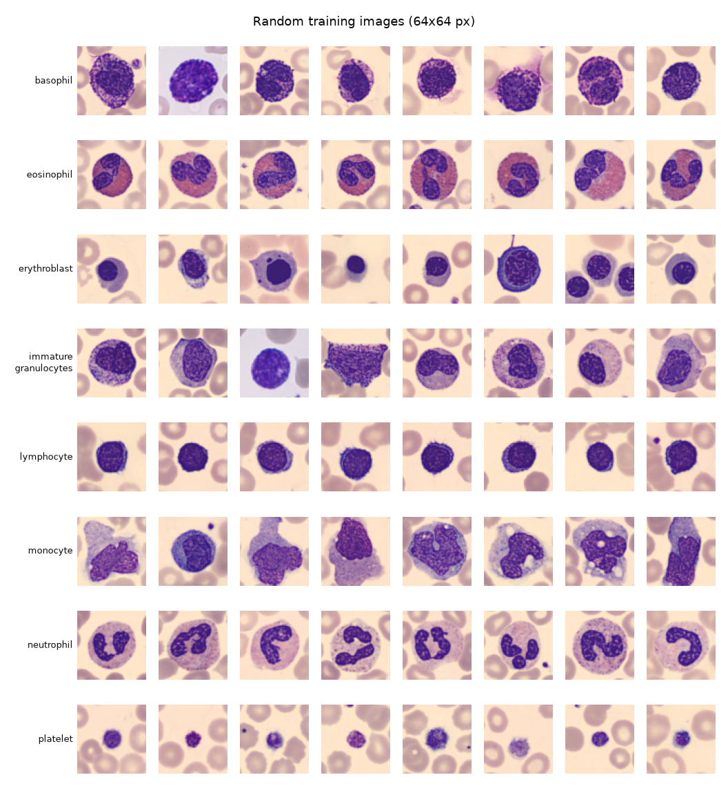

# BloodMNIST dataset report

Generated by `scripts/wbc_dataset_report.py`. The numbers are in [summary.json](summary.json).

## Structure

The dataset is in `data/bloodminst/` (note the spelling: "minst"). It is already split into `train/`, `val/`
and `test/`, and each split has one folder per class: basophil, eosinophil, erythroblast,
immature_granulocytes, lymphocyte, monocyte, neutrophil and platelet. The structure is correct: every split
has the same 8 folders, all 17,092 files are PNG images, and none of them is broken.

| Class | Train | Val | Test | Used? |
|---|---:|---:|---:|---|
| basophil | 852 | 122 | 244 | yes |
| eosinophil | 2,181 | 312 | 624 | yes |
| erythroblast | 1,085 | 155 | 311 | yes, as "not a WBC" |
| immature_granulocytes | 2,026 | 290 | 579 | yes |
| lymphocyte | 849 | 122 | 243 | yes |
| monocyte | 993 | 143 | 284 | yes |
| neutrophil | 2,330 | 333 | 666 | yes |
| platelet | 1,643 | 235 | 470 | no (removed) |
| **Total** | **11,959** | **1,712** | **3,421** | 14,744 used |

## Image size: every image is 64 x 64 pixels

All images are RGB and exactly 64 x 64 pixels. Each one is a single cell, roughly centred, with some of the
neighbouring red cells around it.

**Why this matters.** 64 x 64 is small (not as extreme as the 28 x 28 version of BloodMNIST, but small). The
figure shows the same white blood cell at three sizes. At 64 px the overall shape of the nucleus and the colour
of the cytoplasm survive. The fine details are partly lost: the individual granules and the texture of the
nucleus. Those details are exactly what separates some cell types:

- **basophil vs. eosinophil vs. neutrophil**: the colour and size of the granules
- **monocyte vs. lymphocyte**: the texture of the nucleus and how much cytoplasm surrounds it
- **immature granulocytes**: a mix of stages that look like neutrophils and monocytes

**What we do about it.**

1. The model is trained at 224 x 224. The 64 px images are upscaled, because the pretrained model was built
   for larger images. Upscaling adds no new detail, but it lets the network keep enough spatial resolution
   inside its layers.
2. In the app, each white-blood-cell crop from the photo is **shrunk to 64 x 64 first**, so the classifier
   sees the same level of detail it was trained on, and is then upscaled to 224 like the training images.
3. If the accuracy is not good enough, the best fix is more resolution: MedMNIST+ also publishes BloodMNIST
   at 128 x 128 and 224 x 224, and the original source dataset (PBC, Acevedo et al. 2020) has 360 x 363 images.
   Retraining on one of those needs no code changes, only a new dataset folder.

## Class balance: moderately imbalanced

In the training split the largest WBC class (neutrophil, 2,330 images) is 2.7 times the smallest
(lymphocyte, 849). That is a moderate imbalance, not a severe one. The model sees every class hundreds of
times, so it can learn all of them, but it may lean towards the big classes when it is unsure. To catch this
we report precision and recall **per class**, not only the overall accuracy.

## Duplicates

9 images appear in more than one split (always once in train and once in test), and one of those pairs has
two different labels (eosinophil in train, neutrophil in test). That is 9 out of 3,421 test images, so it
does not change the results, and the original split is kept as asked.

## Which classes the classifier learns

**Erythroblast and platelet are not white blood cells. Decision: remove platelet, keep erythroblast as a
"not a WBC" class.**

- **Erythroblasts** are immature red blood cells that still have a nucleus. In a smear they look a lot like a
  small lymphocyte, so the detector can mark them as "WBC". If the classifier had no erythroblast class, it
  would have to call that cell a lymphocyte (or another WBC type) and the WBC count would be wrong. With the
  class kept, the app shows the cell as "Erythroblast (not a WBC)" and leaves it out of the WBC total.
- **Platelets** never reach the classifier: the detector has its own platelet class and separates platelets from
  white blood cells almost perfectly (WBC precision 1.00 and recall 0.999 on the TXL-PBC test split). A platelet
  class would add nothing except another way to be wrong, so it is removed.

The model therefore learns 7 classes: 6 white-blood-cell types plus erythroblast.

## Samples

