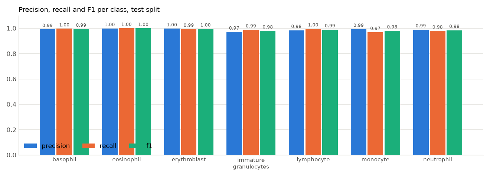
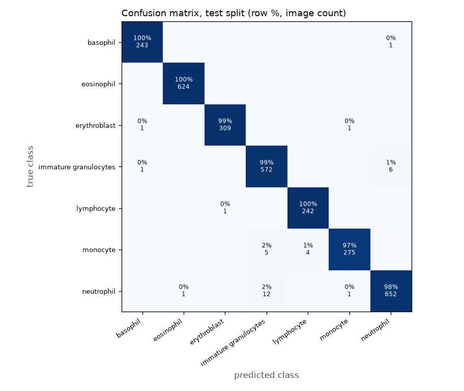
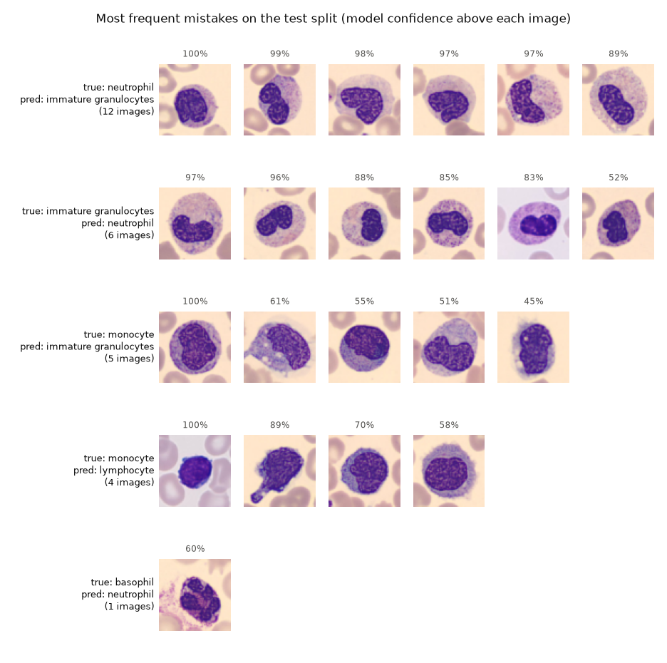
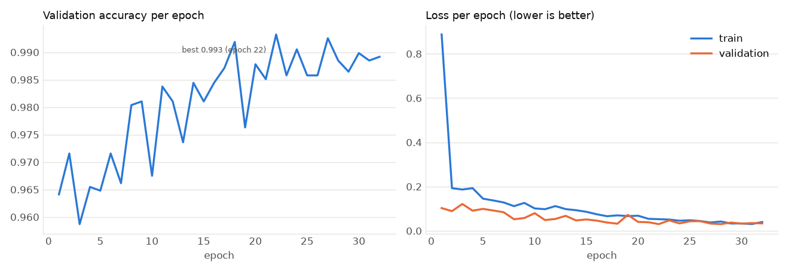

# White-blood-cell classifier: report

`models/wbc_classifier.pt`, a `yolo26s-cls.pt` (ImageNet-pretrained) fine-tuned on BloodMNIST
(7 classes: 6 WBC types plus erythroblast as "not a WBC"). Dataset report: [../wbc_dataset/REPORT.md](../wbc_dataset/REPORT.md).

## Results

| | Accuracy | Macro precision | Macro recall | Macro F1 |
|---|---:|---:|---:|---:|
| **Test** (never seen during training) | **0.988** | 0.989 | 0.989 | 0.989 |
| Validation | 0.993 | 0.991 | 0.994 | 0.992 |

Accuracy is the share of images whose class is predicted correctly. "Macro" means the average over the 7
classes, so small classes count as much as big ones.

### Per class, test split

| Class | Precision | Recall | F1 | Test images |
|---|---:|---:|---:|---:|
| basophil | 0.992 | 0.996 | 0.994 | 244 |
| eosinophil | 0.998 | 1.000 | 0.999 | 624 |
| erythroblast | 0.997 | 0.994 | 0.995 | 311 |
| immature granulocytes | 0.971 | 0.988 | 0.979 | 579 |
| lymphocyte | 0.984 | 0.996 | 0.990 | 243 |
| monocyte | 0.993 | 0.968 | 0.980 | 284 |
| neutrophil | 0.989 | 0.979 | 0.984 | 666 |

- **Precision**: when the model says "monocyte", how often is it really a monocyte?
- **Recall**: of all real monocytes, how many does the model find?
- **F1**: a single score that combines the two.

### What it confuses most

- **neutrophil** predicted as **immature granulocytes**: 12 test images (1.8% of the neutrophils)
- **immature granulocytes** predicted as **neutrophil**: 6 test images (1.0% of the immature granulocytess)
- **monocyte** predicted as **immature granulocytes**: 5 test images (1.8% of the monocytes)
- **monocyte** predicted as **lymphocyte**: 4 test images (1.4% of the monocytes)
- **neutrophil** predicted as **monocyte**: 1 test images (0.2% of the neutrophils)

## Training

- Kaggle Tesla T4 GPU, image size 224 (the 64 px images are upscaled), batch 64,
  up to 40 epochs with early-stopping patience 10, cosine learning rate, vertical and
  horizontal flips.
- Ran 32 epochs in 22.1 min. Best validation accuracy
  0.993 at epoch 22. That epoch's weights are the saved model.

